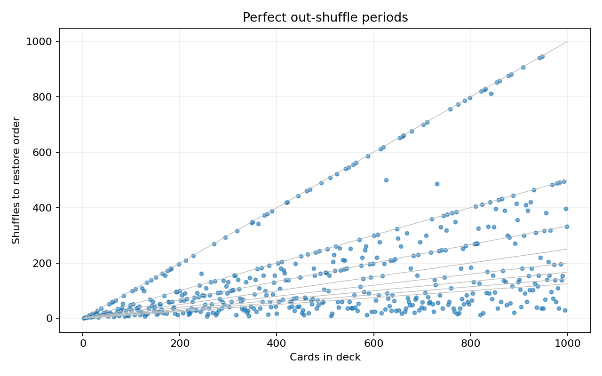

# Faro shuffle periods

Out-shuffle cycle lengths for even deck sizes from 2 through 998.

The shuffle is an **out-shuffle**: split the deck into equal halves and
alternate cards starting with the top half. The first and last cards stay
in place.

```text
Before: 1 2 3 4 5 6 7 8
After:  1 5 2 6 3 7 4 8
```

An eight-card deck returns after three shuffles. A standard 52-card deck
returns after eight.

## Run

Use Python 3.10 or later. Matplotlib is the only external dependency.

```bash
python -m venv .venv
source .venv/bin/activate
python -m pip install -r requirements.txt
python shuffle_test.py
```

In Windows PowerShell, activate with `.venv\Scripts\Activate.ps1`.

To save the plot instead of opening a window:

```bash
python shuffle_test.py --output results/shuffle_periods.png
```



Each point gives the number of shuffles needed to restore the deck. Gray
lines show `N/k` for `k = 1, …, 8`.

## Use the functions

```python
from shuffle_test import intershuffle, checkshufflecycle

deck = list(range(1, 53))
shuffled = intershuffle(deck)
period = checkshufflecycle(deck)  # 8
```

The functions take lists with an even number of cards, at least two.
`intershuffle` returns a new list without changing its input.

For a deck of size `N > 2`, number the positions from zero. Apart from the
fixed bottom card, an out-shuffle maps position `i` to `2i mod (N - 1)`.
The period is therefore the smallest positive `k` with
`2**k = 1 mod (N - 1)`. The script obtains each period by repeated shuffling.
A two-card deck has period one.

## Checks

```bash
python -m unittest discover -s tests -v
```

The checks cover card order, input preservation, known deck periods, and
agreement with the modular-arithmetic result.
